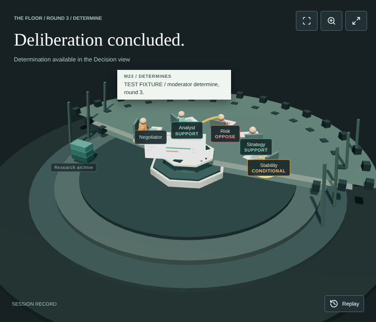

# MetroDesk



**Live demo (read-only recorded runs):** https://metrodesk.pages.dev/

**Demo video:** https://youtu.be/8oRJ1qgdlJE

Emergency planners and exercise facilitators need to see why a response proposal changed, what evidence informed it, and which objections remain. MetroDesk turns a supplied situation, documents and constraints into an inspectable council transcript and cited decision brief, with proposal history and dissent preserved.

Five software agents use NVIDIA Nemotron through Nebius Token Factory in separate calls. Tavily supplies research and source extraction. The Three.js theater shows the actual speaker and execution state beside readable contributions.

## How Nemotron Is Used

Every agent turn is a separate call to NVIDIA Nemotron (`nvidia/Nemotron-3-Ultra-550b-a55b`, override with `NEBIUS_MODEL`) on Nebius Token Factory at `https://api.tokenfactory.nebius.com/v1/chat/completions`, temperature 0.2. A run is 21 contributions: the Negotiator's proposal; in each of three rounds, challenges from the Analyst, Risk, Strategy and Stability reviewers and a Negotiator revision; four final votes; and the Moderator's determination.

- **Structured output.** Each call sends `response_format` type `json_schema` with `strict: true` and a schema built for that operation: proposal ledger, citations, objections, resolutions, evidence requests, vote or determination.
- **Research as tool use.** Within a turn Nemotron can return `search` or `extract` instead of a contribution, up to two times. The server runs the Tavily request, adds the results to the sources and calls Nemotron again.
- **Server validation.** Citations are checked against the exact source text, ledger totals against the budget and minimum reserve, and resolutions against open objections. A rejected answer is returned to Nemotron as a correction. If output is cut off at the token limit, `max_tokens` doubles from 16,384 up to 65,536. After six failed attempts the run pauses for reviewer triage.
- **Receipts.** Every call is recorded with agent, operation, HTTP status, request and response IDs, token usage and duration. Provider reasoning fields are not stored.

Token Factory served as the hosted inference endpoint for Nemotron; it did not speed up development. No other Nebius tools or services were used: no AI Cloud, Serverless Jobs, Serverless Endpoints or DevPods.

## Run

Requires Node.js 22.13 or newer.

```powershell
npm install
if (-not (Test-Path .env)) { Copy-Item .env.example .env }
npm start
```

Open http://127.0.0.1:4400/. Configure server-side Nebius Token Factory and Tavily keys in `.env`, environment variables or Connections. Password fields stay blank for replacement; blank saves retain existing credentials. Configuration is distinct from a successful inference request.

`.env.example` is a public template; `.env` is the private local configuration and is ignored by Git. Never commit provider keys. The default model is `nvidia/Nemotron-3-Ultra-550b-a55b`. Catalog access does not verify inference.

If port 4400 already belongs to your application, stop that instance before restarting the updated server. Alternatively run on another port:

```powershell
$env:PORT = "4401"
npm start
```

An older server is identified by the UI's restart message. Current API version: `metrodesk-1`.

## Workflow

1. Open a session with situation, documents, decision objective, stakeholders and constraints. Planning exercises produce reconciled integer-dollar allocations; evidence reviews do not require a spending ledger. Either accepts an example situation as its planning premise.
2. The Negotiator proposes. Analyst, Risk, Strategy and Stability receive that proposal and preceding contributions in separate calls, and respond.
3. Proposals and challenges must rest on research: before contributing, the agent searches Tavily, extracts a result and cites at least one exact passage. Actual results return to the requester; identical successful retrievals are reused and labeled.
   Missing evidence follows a fixed path. An agent that cites anything other than an extracted source is told to search for it. Evidence that research cannot supply, or that is internal (inventories, contracts, local data), is filed as an evidence request; public evidence must be searched first. A filed request pauses the session as Evidence needed. The reviewer answers each request in text, attaches a document, or declines; answers become citable sources (R or D IDs) and declines are carried into the determination as unresolved. Resume continues from the next contribution.
4. The Negotiator revises, addressing or deferring each open objection. An addressed objection must point to the numbered changes in that revision that address it. Only the four reviewers raise objections, and only in challenge turns. In its next turn, the reviewer who raised an objection marks each addressed resolution verified or rejected; a rejection reopens the objection in a challenge, or records it as disputed in a final vote. Rounds 2 and 3 challenge the previous round's revision directly, so three rounds produce four proposal versions in 21 contributions.
5. Each reviewing agent separately returns support, conditional support or oppose for the final revision. Agreement is computed from those four dispositions. A separate moderator produces the determination.
6. Export the full JSON record or open the readable HTML report containing proposals, transcript, evidence and request records.

The five agents have distinct instructions and persisted participant state. They can use the same underlying model.

## Theater and Outcomes

Brief, Floor, Evidence and Decision are working views. The theater highlights real pending operations and accepted contributions; participant selection opens their contribution history. Sources open with exact cited passages. Recorded replay uses existing messages and makes no provider calls.

Ready, Running, Recovering, Finished, Failed, Stopped, Interrupted and Connection lost remain visible across views. Backend completion opens the Decision view. Connection lost means current status is unknown. Animation and recorded playback cannot overwrite the backend outcome.

Stop aborts the in-flight request. Resume preserves accepted turns and the unfinished operation, including pending research. Server restarts mark active records interrupted. Completion means the determination exists; three revised rounds alone do not block unfinished final votes.

## Architecture and Records

The Node server provides the case API and a reconnectable server-sent state stream. Each saved revision sends an event ID; the browser retrieves authoritative case state and falls back to polling during reconnection.

New cases use `record_version: 2` with `deliberation` participants, messages, proposals, objections, dispositions, operation and determination. Messages reference earlier messages and proposal versions. Provider receipts associate requests with the agent and operation. GET `/api/cases/:id/export` returns JSON; GET `/api/cases/:id/report` returns readable HTML.

Only version 2 deliberation records are loaded; records from the earlier single-model engine are skipped.

Records are local plaintext JSON in `data/`. `data/` is not tracked by Git. When a run ends, it is copied once per revision to `records/` as a read-only file if it is a completed live run: it passes acceptance (21 contributions, four proposal versions, four votes, a determination and linked provider receipts) and used Tavily search and extract. Its flaws are kept, not filtered: unverified citations, unreviewed or disputed objections and declined evidence stay in the record and the determination. `records/` is tracked by Git; review it before committing, since it contains the session inputs. Web text retrieved during the recorded runs belongs to its publishers. Only US federal works, statute and regulation text and openly licensed text are kept; the text of every other source was deleted after the runs, with its citation and URL kept. Every source is listed in `docs/SOURCES.md`. Inputs go to Nebius; research queries and URLs go to Tavily. Provider keys are excluded from saved cases, reports and API configuration responses. Accepted messages link to their provider receipt and decision call. New receipts record requested response format, schema name, attempt and correction number alongside returned identifiers, usage and latency.

## Validation and Recovery

Source citations require exact passages in extracted text; snippets are leads. Passage matching does not verify semantic entailment, legal admissibility or the source's truth. Documents and retrieved content are untrusted inputs. The runtime does not execute embedded instructions or claim prompt-injection immunity.

Supplied events, objectives and constraints are the planning premises, not claims agents must prove happened. Research resolves decision-relevant uncertainties and is required in proposals and challenges. Uploaded documents are registered as extracted sources with their filename, original upload hash and supplied-document provenance, so agents can cite them without Tavily. The server registers only documents it extracted itself, matched by hash and text; a document cannot be registered from brief text or from a hash supplied by the browser. Previously appended documents are registered when a v2 session resumes. A supplied-document citation is not independent corroboration. The response schema is one flat object; action-specific rules (a proposal on a contribution, a query on a search) are enforced by validation. The same schema is included in the model instructions as well as the API request. A located quote is recorded as passage_located: it shows the passage exists, not that it supports the claim.

Scenario proposals reconcile headline amounts, reserve, phase items, actor totals and unique ledger IDs. Revisions address or defer recorded objections. Missing evidence and objections can remain unresolved in a completed determination.

Each model request is bounded to 240,000 characters of input: the current and previous rounds stay complete, older messages, closed objections and answered requests are compacted, and sources not in play become excerpts. If it still does not fit, the request fails rather than sending an oversized prompt.

Invalid responses feed correction into the unfinished agent turn. Truncation regenerates complete JSON with increasing output allowance, up to 65,536 tokens. Six consecutive invalid answers pause the session as Needs triage: the reviewer keeps, defers, withdraws or merges open objections with a reason, and the same turn resumes; accepted work is kept. Refusals and provider connection errors remain explicit. Each agent turn can use two research actions before contributing, preventing endless research without a response.

## Verification

`npm test` runs the automated tests (Node's built-in runner, no extra packages): passage matching, ledger reconciliation, agreement, sign-in rules and limits, the CSP, key redaction in provider errors, document registration, report escaping, model-output parsing, server checks (paths, host, origin, server-extracted documents, config without keys) and the recorded runs (structure, removed third-party text, every source listed in `docs/SOURCES.md`).


Inspect an actual saved case without generating or replacing contributions: `node scripts/inspect-recorded-ui.mjs CASE_ID`. Set `BUNDLED_MODULES` to a `node_modules` directory that contains Playwright; `CHROME_PATH` overrides the default Chrome location. This produces desktop/mobile screenshots and diagnostics labeled recorded, read-only inspection. It makes no provider calls and cannot establish new live completion.

Start the current server with `npm start`, then execute acceptance from a second PowerShell terminal. These commands make paid runtime requests through that server; the runner never writes directly into its case store.

```powershell
npm run accept:live -- --case CASE_ID
npm run accept:live -- --brief PATH_TO_BRIEF --require-research
```

Use `--base http://127.0.0.1:4410` for another local port, or `--base https://your-host` for an authenticated deployment. `--brief`, `--mode`, `--title` and `--objective` select a new inquiry. `--case` resumes an existing v2 case, preserving its prior receipts and responses. The runner refuses to take ownership of an already running case and only stops a run matching its own run ID.

JSON, HTML and acceptance-inspection artifacts are written to `artifacts/`. Checks require three rounds, four proposal versions, 21 accepted contributions, four independent reviewer dispositions, a determination and linked successful provider receipts. `--require-research` additionally checks Tavily search/extract receipts and a cited challenge-to-revision dependency. Inspect the actual passages and proposal changes to establish material evidence influence; structural checks alone cannot prove it.

## Submission

Targets Best Apps and Agents and functional Tavily integration. See `docs/SUBMISSION.md`, `docs/DEMO.md` and `docs/PROVIDER-FEEDBACK.md` for delivery status, the under-three-minute demo and factual provider feedback. The deadline is October 30, 2026, at 1 p.m. Eastern.

Public repository: https://github.com/wpimedia1/MetroDesk. The MIT license is included. Read-only demo: https://metrodesk.pages.dev/. Demo video: https://youtu.be/8oRJ1qgdlJE. Bundled libraries keep their own licenses: Three.js (MIT, `public/vendor/THREE-LICENSE.txt`) and Lucide (ISC, `public/vendor/LUCIDE-LICENSE.txt`). Third-party web text in `records/` is not covered by the MIT license; see `docs/SOURCES.md`.

## Read-only Demo

`node scripts/build-static.mjs` builds `dist/`: a landing page (`static/splash.html`) and, at `app.html`, a read-only copy of the app containing the archived runs in `records/`. It needs no server and no provider keys and makes no API calls: sessions open from files, and Replay, the Floor, Evidence, Decision, the readable report and the JSON export work; starting or changing a session is disabled. Host `dist/` on any static host. On Cloudflare (Workers & Pages, imported from GitHub), use build command `node scripts/build-static.mjs` and deploy command `npx wrangler deploy`; `wrangler.jsonc` serves `dist/` as static assets. To run new sessions, run the server locally with your own keys (see Run).

## Hosted Judge Access

Configure provider keys server-side. Set `HOST=0.0.0.0`, `APP_ORIGIN=https://your-host`, `METRODESK_USERNAME` and `METRODESK_PASSWORD`; public binding refuses startup without HTTPS origin and credentials. Built-in HTTP Basic authentication protects the entire application, including API, records and connections. Terminate TLS at a reverse proxy and do not expose the internal HTTP port. Give trusted judges application credentials, never provider keys. After 10 failed sign-ins within 15 minutes, a connecting address is refused until the window ends; behind a reverse proxy all clients share the proxy's address, so also rate-limit sign-ins at the proxy. App pages are served with a Content-Security-Policy, and error responses do not include server file paths. The acceptance runner reads these credentials privately from the environment or `.env`.

## Limitations

Software-agent agreement does not represent stakeholder consent. Sharing one model does not establish statistical independence. Scenario assumptions are planning inputs, not verified incident facts. Exact citation matches establish passage provenance, not truth, semantic entailment, document authenticity or legal admissibility. Supplied documents do not independently corroborate their own claims.

Provider receipts reflect returned metadata, not independent billing attestation. This is a shared-session instance for trusted users, not a multi-tenant hosted service.

Rules: https://nebiusglobalaihackathon.devpost.com/rules
Organizer tips: https://nebiusglobalaihackathon.devpost.com/updates/46205-how-to-build-a-winning-project
